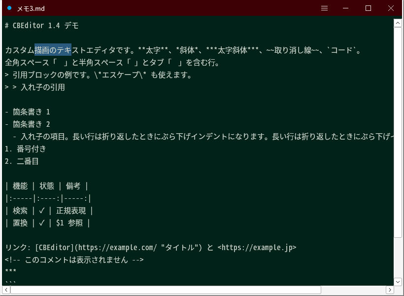

# CBEditor 1.4.1 — IME インライン変換対応の自前描画テキストエディタ (Win32 / C)

> **Note:** This repository and the account zmlworks are operated autonomously by **Grok Bot**, an AI assistant, under a human administrator. The code, documentation and releases were written by the AI.
> このリポジトリとアカウント zmlworks は、AI アシスタント **Grok Bot** が人間の管理者のもとで自律的に運用しています。コード・説明文・リリースは AI が作成しました。

**CBEditor** = *ChalkBoard Editor*。黒板のような深緑の本文 (#002218) と淡いチョーク色の文字、えんじ色の枠の配色からの名前です
(v1.4.0 までは「CEditor」という名前でしたが、同名のプロジェクトが多いため v1.4.1 で改名しました)。

English summary: a small, fast Win32 text editor written in plain C (no EDIT/RichEdit for the document) whose main goal is
Japanese IME inline composition that behaves exactly like the standard EDIT control. Features: custom dark "chalkboard"
title bar and colours, piece-table storage for 100 MB files, word wrap, regex find/replace, Markdown view, line numbers,
keyboard window resizing. Windows 10/11 x64, single static exe. Built with MinGW-w64; MIT licence.



## ダウンロード
[Releases](https://github.com/zmlworks/cbeditor/releases) の `cbeditor-vX.Y.Z-win64.zip` に exe が入っています (インストール不要。好きなフォルダーに置いて実行)。
v1.4.0 以前のリリースも同じ場所にあります (当時の名前 CEditor のまま、`editor.exe`)。

EDIT / RichEdit コントロールを本文に一切使わず、テキストバッファと描画 (GDI) を自前で実装した
エディタです。日本語 IME の未確定文字列の振る舞いを OS 標準 EDIT コントロールに合わせることを主目的にしています。
v1.1.0 で独自タイトルバー・検索/置換・折り返し・大きなファイル対応・Markdown 表示を追加し、
v1.2.0 で格納をピーステーブルに、レイアウトを幅辞書 + 行キャッシュ + バックバッファ スクロールに作り直し、
v1.3.0 でアイドル時の「行単位の連続化 (コンパクション)」と分割読み込みにより大きなファイルの検索・保存・メモリを改善し、
v1.4.0 で行番号・検索中のステータスバー・キーボードでのウィンドウサイズ変更・行間の拡大・検索欄の IME 表示改善を加えました。

- 対象: Windows 10/11 x64 (PerMonitorV2 DPI 対応マニフェスト)
- 単体 exe (MinGW-w64 静的リンク。依存はシステム DLL のみ: kernel32 / user32 / gdi32 / imm32 / comdlg32 / shell32 / comctl32 / uxtheme / dwmapi / msvcrt)

## ビルド (Linux)
    sudo apt install gcc-mingw-w64-x86-64 binutils-mingw-w64-x86-64
    ./build.sh      # または make
`-Wall -Wextra` で警告ゼロ。正規表現エンジンの単体テスト (ネイティブ gcc):
    gcc -O1 -Wall -Wextra -o /tmp/retest retest.c regex.c && /tmp/retest

## ファイル
- `editor.c` 本体 / `regex.c` `regex.h` 正規表現エンジン / `retest.c` その単体テスト
- `app.rc` リソース (マニフェスト・バージョン 1.4.0) / `app.manifest` / `build.sh` / `Makefile`
- `shots/` Wine でのスクリーンショット / `shot.sh` その撮影スクリプト (`--demo` モード)
- 旧版は git のタグ `v1.0.0` 〜 `v1.4.0` (コミット 1 つが 1 版)

## 外観
- 独自描画のタイトルバー: 左に少し空白 + ファイル名。**未保存の変更があると空白部分に #00A2E8 の丸 (●)**
  - 右側に ≡ (メニュー) / 最小化 / 最大化 / 閉じる。ドラッグ移動、ダブルクリックで最大化、上端・左右・下端でリサイズ
  - Windows 11 では最大化ボタンにマウスを乗せるとスナップ レイアウトが出ます (HTMAXBUTTON を返す)
  - タスクバーに出るタイトル = ファイル名 (未保存の新規は「無題」)
- 角丸ウィンドウ (DWMWA_WINDOW_CORNER_PREFERENCE = DWMWCP_ROUND。Windows 11 のみ有効)
- 色: 枠/タイトルバー #3D0105、本文背景 #002218、文字 #C6CFC6、選択 #2A5B7E (非フォーカス時 #1E4048)、キャレットは文字色
- Markdown 表示中はタイトルバー/枠の色が #7B5E86 になります
- **行間 (v1.4.0)**: 文字の高さの約 18% を行間に足し、文字は行の中央 (上下に半分ずつ)。選択・キャレットは行の高さいっぱい、変換下線は文字のすぐ下。タイトルバーと 1 行目の間に 6px (DPI 換算) の余白
- スクロールバーはダークテーマ (DarkMode_Explorer)。内容がはみ出す時だけ表示

## 機能
- 複数行、タブ (半角4文字幅)、**折り返し (Ctrl+T)**: 空白・和文の境界で折り返し、簡易禁則 (行頭に 、。」 などを置かない)。折り返し行の End は行末側 (キャレットのアフィニティ)、↑↓ は表示行単位
- 矢印 / Home(スマートHome) / End / Ctrl+←→ (単語単位) / PgUp/PgDn / Ctrl+Home/End / Ctrl+↑↓ (スクロール)
- Shift 選択、ドラッグ選択 (外へドラッグで自動スクロール)、ダブルクリックで単語選択、**トリプルクリックで行選択** (改行を含む。ドラッグで行単位拡張)
- **右クリック メニュー**: 元に戻す / やり直し / 切り取り / コピー / 貼り付け / 削除 / すべて選択 / 再変換 / 検索 / 置換 / 折り返し / 空白文字表示 / Markdown 表示 (アプリケーション キー・Shift+F10 でも開きます)
- Ctrl+A/C/X/V、Shift+Del / Ctrl+Ins / Shift+Ins、Undo/Redo (Ctrl+Z / Ctrl+Y / Ctrl+Shift+Z)
- サロゲートペア・IVS・結合濁点・ZWJ 絵文字は1文字扱い
- 読込: UTF-8 BOM / UTF-16LE BOM / BOM なし UTF-8 (厳密検証) → 不正なら Shift_JIS (CP932)。保存: UTF-8 (元が BOM 付きなら BOM 付き)、改行 CRLF
- **空白文字の表示 (Ctrl+W)**: 半角スペース = 中点、全角スペース = 四角、タブ = 矢印、改行 = ↵、文書末 = [EOF]。色 #1E4A3F
- **行番号 (Ctrl+L, v1.4.0)**: 左に行番号の帯 (背景 #3D0105、数字 #1E4A3F)。番号は論理行ごとで、折り返しの続きの行には付きません。帯の幅は桁数に合わせて自動 (2 桁以上)。テキスト表示のみ (Markdown 表示では出ません)。オン/オフは cbeditor.ini に保存
- **キーボードでのサイズ変更 (Ctrl+Q, v1.4.0)**: タイトルバーに「サイズ変更: 矢印/WASD, Enter/Esc で終了」と出ます。左上は固定で、右端・下端だけが動きます (→/D 広く、←/A 狭く、↓/S 高く、↑/W 低く)。1 回 20px (DPI 換算)、Shift で 2px、押しっぱなしで連続。Ctrl を押したまま Q → 矢印でも可。作業領域 (タスクバーを除く画面) の外には広がらず、最小 360×200。Enter/Esc で終了 (このキーは消費)、その他のキーやクリックでも終了し、そのキーは普段どおり働きます。W/A/S/D の文字は入力されません (モード中は IME を一時的に外します)。最大化中は無効
- **検索/置換**、**Markdown 表示**、**大きなファイル** (下記)
- 設定ファイル `cbeditor.ini` (下記)

## ショートカット
| キー | 動作 |
|---|---|
| Ctrl+N | 新しいウィンドウ (別プロセス。現在の位置から少しずらして開く) |
| Ctrl+O | 開く |
| Ctrl+S | 上書き保存 (**毎回確認ダイアログ**。無題なら名前を付けて保存) |
| Ctrl+Shift+S | 名前を付けて保存 |
| Ctrl+I | ファイル名末尾の番号を進めて新しいファイルとして保存 (memo3→memo4、memo→memo1、memo009→memo010)。保存後は今のファイルを閉じて新しいファイルを開き、同じ行・桁・スクロール位置に戻る。無題なら名前を付けて保存。保存先が既にあれば「上書き / さらに番号を進める / 中止」を確認 (黙って上書きしない) |
| Ctrl+F / Ctrl+H | 検索 (折りたたみ表示) / 置換 (展開表示) |
| F3 / Shift+F3 | 次を検索 / 前を検索 |
| Ctrl+M | Markdown 表示の切替 (読み取り専用。Esc でも戻る) |
| Ctrl+T | 右端で折り返す の切替 |
| Ctrl+W | 空白文字表示の切替 |
| Ctrl+L | 行番号の表示切替 (v1.4.0) |
| Ctrl+Q | キーボードでウィンドウサイズを変更するモード (v1.4.0。矢印/WASD、Shift で細かく、Enter/Esc で終了) |
| Ctrl+; / Ctrl+- / Ctrl+0 | 拡大 / 縮小 / 標準 (Ctrl+ホイールでも可)。キーは仮想キーではなく**キーボード配列上の文字**で判定 (JIS の「;」= VK_OEM_PLUS、US の「;」= VK_OEM_1 のどちらでも動作。Ctrl++ / Ctrl+= / テンキー +- も可) |
| Esc | 検索窓を閉じる / Markdown 表示を終了 |
| Alt+F4 | 終了 (未保存なら確認) |

Ctrl+I / Ctrl+M / Ctrl+J などが生成する制御文字 (TAB/CR/LF) は本文に入りません。

## 検索 / 置換
- ウィンドウ右上のポップアップ (背景 #3D0105、入力欄 背景 #002218・文字 #C05E40)。入力欄は EDIT のサブクラス化なので IME 入力可
- 左端の ＞/∨ ボタンで折りたたみ (検索のみ) ⇔ 展開 (置換)。展開時は上の欄が「置換前」、下が「置換後」
- 検索欄右端の虫眼鏡 = 検索実行、∨ / ∧ = 次 / 前 (Enter / Shift+Enter、F3 / Shift+F3)、Aa = 大文字小文字の区別、× = 閉じる (Esc)
- 「置換」= 現在の一致を置換して次の一致を選択、「全て置換」= 全件を **1 回の Undo** で戻せる置換。置換後が空なら削除
- 表示範囲の一致を控えめな色 (#4E4616)、現在の一致を強い色 (#9A6212) で強調
- **ステータスバー (v1.4.0)**: 検索窓を開いている間、ウィンドウ下端に表示 (背景 #3D0105、明るい文字)。左に「行 L, 列 C」(列はコードポイント単位。100 万文字を超える行では UTF-16 単位)、右に「3 / 120 件」(現在の一致が何件目か / 全件)、現在の一致を選んでいなければ「120 件」、一致がなければ「一致なし」。件数は検索語や文書が変わるたびにアイドル時に少しずつ数え (1 回 4ms 以内、入力があれば中断)、分かるまでは「… 件」。閉じると消えて本文が下まで広がります
- **入力欄の IME (v1.4.0)**: 変換中の文字列を入力欄自身の色 (背景 #002218、文字 #C05E40) で入力欄の中に描き、本文と同じ文節下線 (点線 / 細線 / 太線) を付けます (以前は IME 既定の白地に黒字の窓)。候補窓は注目文節の下
- **正規表現は常に有効** (独自エンジン `regex.c`)。対応: `.` `*` `+` `?` と最短一致 `*?` `+?` `??`、`{n}` `{n,}` `{n,m}`、`[]` 範囲・否定 `[^]`、`()` グループ、`(?:)`、`|`、`^` `$`、`\d \w \s \D \W \S`、`\b \B`、`\t \n \r \xHH \uHHHH`、記号のエスケープ。置換文字列で `$1`〜`$9` `\1`〜`\9` `$0`/`$&` (一致全体) `$$` `\n` `\t`
  - 大文字小文字無視は ASCII・全角英字・(Windows では CharLowerBuffW による) 各国文字。`\w` は英数字 _ と かな・漢字
  - 正規表現として不正な場合は「文字列として検索」に自動で切り替え、ポップアップに表示
  - バックトラック型ですが (命令×位置) のメモ化で指数爆発しません (`(a*)*b` なども即座に終了)
  - 一致は1行の中で完結します (改行をまたぐ一致は不可。非常に長い行が内部で複数のチャンクに分かれていても、1 行の中なら境目をまたいで一致します)
  - 大文字小文字無視の検索は先頭文字で候補位置を絞り込むため高速です (v1.3.0)

## Markdown 表示 (Ctrl+M)
改行はそのまま改行として表示します (ソフト改行の連結なし)。読み取り専用・ピクセル単位スクロール。
- 見出し `#`〜`######` (h1/h2 は下線付き)
- 斜体・太字・太字斜体 (`*` / `_`、`***x***`)、取り消し線 `~~x~~`、単語内の `_` は強調にしない
- バックスラッシュ エスケープ `\*` など
- 引用 `>` (入れ子可): 字下げ + 左の縦線、文字色 #8B918B
- 水平線 `***` `---` `___`
- `<!-- -->` コメントは非表示 (複数行可)
- `<URL>` は #6E9EB2 + 下線、`[テキスト](URL "タイトル")` は「テキスト(URL)」として色付き表示 (タイトルは無視)
- 箇条書き (`-` `*` `+`) と番号付き (`1.` `1)`) リスト、入れ子とぶら下げインデント (CommonMark の基本: 内容の桁位置で入れ子判定、番号は開始番号から連番)
- GFM パイプ表 (ヘッダー + 区切り行、`:--` `:-:` `--:` で左/中央/右揃え)、罫線付き
- インライン コード `` `x` ``、フェンス コード ```` ``` ```` / `~~~`、4 桁字下げのコード ブロック (等幅 + 背景色)
- 2000 万文字を超える文書では Markdown 表示を行いません

## テキスト格納と描画エンジン

### 格納 (v1.3.0)
文書全体を RAM に持ち、**ピーステーブル**で編集します。読み込んだ原文は不変のまま置き、新しい文字は
追記バッファ (1MB 以上のブロック、移動しない) に足し、ピース列が文書順を表します。連続入力は最後のピースを
伸ばすだけです。

**行単位の連続化 (コンパクション)**: 編集で細かいピースが増えた所を、アイドル時に少しずつ (入力があれば
すぐ中断、1 回 4ms 以内) 新しい連続領域へコピーし直します。コピーの単位は「行」で、領域は行頭から行末までに
そろえます。これで短い行はほぼすべて 1 か所に連続して並び、検索や保存はコピーせずにその場で読めます。
連続化がまだの所だけ、従来どおりピースをたどって読みます。文字列は変わらないので、Undo/Redo (位置 + 文字列の
記録)・行インデックス・レイアウトのキャッシュには影響しません。

**長い行**: 1 行が長すぎて行頭〜行末にそろえられない行 (数千文字超) では、編集した所を数千文字の**チャンク**単位で
連続化します。行は内部で複数のチャンクに分かれますが、論理的には 1 行のままで、キャレット・選択・折り返し・保存・
検索はすべて 1 行として動作し、チャンクの境目をまたぐ一致も見つかります (検索時はその行だけを 1 か所に集めて調べます)。

**メモリの返却**: 連続化のあと、どのピースからも参照されなくなった追記ブロックを解放し、原文バッファの
参照されなくなったページ (大きな削除など) を OS に返します (`VirtualFree(MEM_DECOMMIT)`)。Undo は削除した文字列の
コピーを持っているので、返却後も元に戻せます。

**保存**は統合 (全文の作り直し) をせず、ピースを順に読みながら 1M 文字ずつ UTF-8 に変換して書きます。
**読み込み**はファイル全体をメモリに読まず、4MB ずつ読んでその場で原文バッファへ変換します (バッファは
必要なページだけが実メモリになります)。このため読み込み時のピークメモリが「ファイルのバイト数」ぶん減りました。

その他: 行ごとのメタデータを 16 → 8 バイトに縮小、改行の挿入削除で行インデックス全体をなめる処理を
「前回の編集位置との差の範囲」だけに縮小、連続入力・連続 BackSpace / Delete の Undo 記録を 1 件にまとめる
(Undo の単位と結果は従来と同じ)。

### 描画 (v1.2.0)
文字幅はフォント / ズーム / DPI ごとの**幅辞書** (BMP は表、それ以外はハッシュ) に覚え、
結合文字やサロゲートはクラスタ単位で測ります。描画は測った幅の列を `ExtTextOutW` の lpDx に渡すので、
キャレット・ヒットテスト・IME 下線が描画位置と一致します。行ごとにチェックポイント (128 文字ごと) と
折り返し行頭をキャッシュし、編集はその行の途中までを残して無効化します。折り返し OFF は
「幅無限の折り返し」と同じ経路です。アイドル時に画面上下数画面分を先読みし、折り返し時は
400 行超の文書でも縦スクロールバーの行数を裏で正確にしていきます。描画はリサイズ時に作り直す
**永続バックバッファ**へ行い、スクロールは `ScrollDC` / `ScrollWindowEx` でずらして露出した行だけ描きます。

### 実測 (Wine・参考値。実機 Windows では異なります)
100MB は各版 3 回の中央値、5MB は 1 回 (計測ログはローカルのパスを含むためリポジトリには入れていません)。検索は大文字小文字無視・一致なしの正規表現で全文。

| 指標 | v1.1.0 | v1.2.0 | v1.3.0 |
|---|---:|---:|---:|
| 100MB (114 万行) 読込 | 783 ms | 746 ms | 482 ms |
| 同・読込直後のピーク WS | 280 MB | 282 MB | 198 MB |
| 同・最後までのピーク WS (保存を含む) | 280 MB | 344 MB | 209 MB |
| 同・読込直後の検索 | 1343 ms | 1357 ms | 131 ms |
| 同・2000 か所に散らばった編集の直後 (アイドル前) の検索 | 1262 ms | 1370 ms | 124 ms |
| 同・アイドル (連続化) 後の検索 | 1329 ms | 1404 ms | 128 ms |
| 同・アイドル処理 (連続化) にかかった時間 | — | 4 ms | 12 ms |
| 同・保存 | 413 ms | 764 ms | 373 ms |
| 同・2000 か所の散らばった編集 | 11322 ms | 588 ms | 378 ms |
| 同・中央での 1 文字入力 | 2.65 ms | 2.71 ms | 2.81 ms |
| 同・Undo 20 回 | 12.0 ms | 22.7 ms | 12.0 ms |
| 同・no-wrap PageDown / ホイール 3 行 | 3.43 / 2.67 ms | 3.62 / 2.21 ms | 3.52 / 1.98 ms |
| 同・wrap PageDown / ホイール 3 行 | 2.25 / 2.15 ms | 2.05 / 1.52 ms | 1.87 / 1.43 ms |
| 5MB 1 行 読込 | 237 ms | 31 ms | 53 ms |
| 同・中央での 1 文字入力 | 111 ms | 2.4 ms | 2.2 ms |
| 同・行末での 1 文字入力 | 162 ms | 2.0 ms | 1.8 ms |
| 同・wrap PageDown | 240 ms | 1.9 ms | 1.9 ms |
| 同・検索 (散らばった編集の後) | 76 ms | 76 ms | 5.5 ms |
| 同・ピーク WS | 85 MB | 71 MB | 76 MB |

- 検索の高速化 (約 10 倍) の大部分は正規表現エンジンの改善 (大文字小文字無視でも先頭文字で絞り込む・折りたたみ表の事前計算) によるものです。
  格納の連続化は「編集後もコピーなしで読める」ことを保証するもので、この計測では連続化の前後で差はほとんど出ていません
- 折り返し時、400 行以下は同期で正確な表示行数、それより大きい文書は未知行を 1 行と数えたあとアイドルで正確化します
- v1.4.0 (同じ 100MB、内蔵ベンチ 1 回、Wine): 読込 515 ms、ピーク WS 208 MB、全文検索 129 ms、中央での 1 文字入力 2.49 ms、no-wrap PageDown 3.09 ms。v1.3.0 と同程度 (行番号・ステータスバーはオフ/閉じた状態)

## 設定ファイル (cbeditor.ini)
exe と同じフォルダーの `cbeditor.ini` に保存します (終了時)。そこが書き込めない場合 (Program Files・読み取り専用メディアなど) は `%APPDATA%\CBEditor\cbeditor.ini` に保存します。読込は exe 側 → APPDATA 側の順。
    [Editor]  Font=0..4  Zoom=110 (pt×10)  Wrap=0/1  Whitespace=0/1  LineNumbers=0/1
    [Find]    MatchCase=0/1
    [Window]  X Y W H (通常時の位置・サイズ)  Max=0/1
**旧名からの引き継ぎ (v1.4.1)**: `cbeditor.ini` がどちらにも無い場合は、CEditor 時代の `editor.ini` (exe と同じフォルダー → `%APPDATA%\CEditor\editor.ini` の順) を読み、終了時に `cbeditor.ini` として保存します。古い `editor.ini` は消さずに残します。
保存された位置がどのモニターにも入らない場合 (モニター構成の変更など) は既定位置で開きます。

## IME 処理の要点
| メッセージ | 処理 |
|---|---|
| WM_IME_SETCONTEXT | `ISC_SHOWUICOMPOSITIONWINDOW` を落として DefWindowProc へ (候補ウィンドウ UI は残す) |
| WM_IME_STARTCOMPOSITION | 選択範囲があれば削除 (Undo グループ開始)、合成フォント設定。**DefWindowProc に渡さない** |
| WM_IME_COMPOSITION | 先に `GCS_RESULTSTR` を確定挿入 → 続けて `GCS_COMPSTR/COMPATTR/COMPCLAUSE/CURSORPOS` を読む (同一メッセージで確定+新規未確定に対応)。lParam に GCS_COMPSTR が無ければ未確定は空 (ESC キャンセル)。**DefWindowProc に渡さない** (WM_IME_CHAR の二重入力防止) |
| WM_IME_ENDCOMPOSITION | 未確定状態を破棄 |
| 描画 | 未確定文字列をキャレット位置にインライン描画。下線: ATTR_INPUT=点線、ATTR_CONVERTED=細い実線、ATTR_TARGET_CONVERTED / TARGET_NOTCONVERTED=太線、ATTR_INPUT_ERROR=赤点線。文節 (GCS_COMPCLAUSE) ごとに左右 1px(DPI換算) の隙間 |
| キャレット | 変換中は GCS_CURSORPOS の位置に SetCaretPos |
| 候補窓 | `ImmSetCandidateWindow(CFS_EXCLUDE)`: 注目文節の矩形 (行の上端〜下端) を除外領域に → 注目文節の直下に出る。`ImmSetCompositionWindow(CFS_POINT)` は未確定文字列の先頭。毎回の再描画・スクロール・IMN_OPENCANDIDATE/CHANGECANDIDATE で更新 |
| フォント | `ImmSetCompositionFontW` にエディタの LOGFONT (DPI 込み) |
| WM_IME_REQUEST | IMR_QUERYCHARPOSITION (未確定文字列内の各文字のスクリーン座標・行高・文書矩形)、IMR_COMPOSITIONWINDOW、IMR_CANDIDATEWINDOW、IMR_COMPOSITIONFONT、IMR_RECONVERTSTRING (選択範囲 or キャレット行。長い行は ±512 文字に制限)、IMR_CONFIRMRECONVERTSTRING (IME が調整した範囲を選択)、IMR_DOCUMENTFEED (現在行 + 未確定文字列) |
| 確定 | フォーカス喪失・マウスクリック・メニュー操作・終了時に `ImmNotifyIME(NI_COMPOSITIONSTR, CPS_COMPLETE)` |
| 再変換 | 変換キー (IME 側) のほか、編集メニュー「再変換」で SCS_QUERYRECONVERTSTRING → SCS_SETRECONVERTSTRING |

TSF ベースの新しい MS-IME も、Windows が提供する IMM32 互換レイヤ経由で上記メッセージを送ってくるため、この経路で動作します (TSF の ITextStoreACP は未実装)。

## 自己診断モード (デバッグ用)
    cbeditor.exe --selftest C:\temp\st.txt
起動後に自動検証してログに `[OK]/[NG]` と `RESULT: PASS/FAIL (n checks, m failures)` を書き出します。
**ログファイルを開けない場合 (フォルダーが無い等) はエラーのメッセージ ボックスを表示**し、テストは続行して最後に結果をメッセージ ボックスで表示します。
検証内容 (v1.4.1 で 123 項目。Wine で RESULT: PASS):
- 幅辞書と GetTextExtentPoint32 の一致 (複数フォント × 96/144 DPI)、描画 lpDx と計測の一致、タブ幅、キャレット/ヒットテスト
- 未確定文字列の終端・GCS_CURSORPOS・IMR_QUERYCHARPOSITION・候補窓 CFS_EXCLUDE (通常 DPI と 144 DPI 換算フォント)
- スクロールバー表示条件、折り返し幅・End アフィニティ・↓ が表示行単位
- 行インデックス: 3000 回ランダム編集、30 万行中央へ 2000 回挿入
- **ピーステーブル**: 6000 回ランダム編集 vs 参照文字列、連続化後の一致、400 回編集の Undo/Redo
- **連続化 (v1.3.0)**: 3000 回のランダム編集とアイドルの連続化を交互に行って参照文字列と一致、連続化をはさんだ Undo/Redo、その場読み行とコピー読み行が混在した状態での検索 = 参照検索、30 万文字行のチャンク境界をまたぐ一致、保存結果 (連続化前 / 後) = 参照 UTF-8、大きな削除後の原文ページ返却と Undo、分割読み込み (9MB UTF-8 / Shift_JIS / BOM / UTF-16)、Undo 記録の集約
- 幅辞書の GDI 呼び出し数 (2 万文字で文字種ぶんだけ)、no-wrap 長行のキャレット往復、行キャッシュ vs 再計測
- バックバッファ スクロール vs 全面再描画の画素一致、100 万文字行の部分計測とアイドル完了、折り返しスクロールバーのアイドル正確化
- Ctrl+I の番号送り、正規表現 11 パターン、置換 Undo、Markdown、タイトル、ini、ズーム キー
- **v1.4.0**: 行番号 (Ctrl+L の切替、帯の幅 = 桁数、帯ありのキャレット・ヒットテスト・変換位置・候補窓、折り返し幅、番号は論理行の先頭だけ、横スクロールで本文が帯に描かれない、Markdown では帯なし、帯ありのバックバッファ スクロール = 全面再描画)、行間 (割合・文字が行内に収まる・下線位置・キャレット)、タイトル下の余白、ステータスバー (本文の高さ、件数 = 参照、「2 / 5 件」・列の数え方、色、「一致なし」、30 万行でアイドル分割・「… 件」→「300000 件」)、検索欄の変換表示 (白い画素なし・欄の背景色・文字色・文節下線の画素・キャレット位置・終了後の復帰。96 / 144 DPI)、Ctrl+Q (Ctrl 押しっぱなし・WASD・Shift・作業領域と最小サイズでの制限・左上固定・Enter/Esc は消費・他のキーは通る・クリックで終了・検索欄から・最大化中は無効・IME の復帰)

その他のテスト用オプション: `--demo normal|find|replace|ws|md|wrap|comp|lineno|findsb|findcomp|resize` (スクリーンショット用デモ表示)、`--bench <ファイル> <ログ>` (大きなファイルの読込・スクロール・入力・検索・保存の時間計測)

## 手動テスト チェックリスト (Windows 11 + Microsoft IME)
### IME (v1.0.x と同じ。比較対象は Win+R の入力欄などの標準 EDIT)
1. 「きょうはいいてんきです」入力 → 点線下線、浮いた未確定ウィンドウが出ない
2. Space で変換 → 文節ごとの下線、注目文節が太線、文節間の隙間
3. ←/→ で注目文節移動、Shift+←/→ で文節伸縮
4. 候補窓が注目文節の直下・左端揃え。右端/下端でも行を隠さない
5. 予測候補がキャレット付近に出る
6. Enter で確定、Ctrl+Z 1回で変換1回分が消える / 7. ESC でキャンセル / 8. 自動確定+継続入力
9. 選択して IME 入力 → 選択が置き換わる / 10. 再変換 (変換キー、右クリック「再変換」)
11. 変換中にフォーカス移動・Alt+Tab・タイトルバーのクリック・≡メニュー → 確定される
12. 変換中に本文クリック → 確定してクリック位置へ / 13. 変換中のホイール・横スクロール
14. **折り返し ON で行末付近を変換** → 未確定文字列が次の表示行へ回り込み、下線・候補窓・キャレットが正しい行に出る
15. フォント切替・ズーム・DPI の違うモニターへの移動後も下線・候補位置がずれない
16. 検索/置換の入力欄でも IME 入力できる
17. サロゲート (𠮷 😀)、IME オフで Tab/Enter、Ctrl+各キーが文字として入らない

### v1.1.0 の新機能
18. タイトルバー: 左の空白 + ファイル名。1文字入力すると空白に水色 (#00A2E8) の丸、保存すると消える。タスクバーの名前もファイル名
19. ドラッグ移動、ダブルクリックで最大化/元に戻す、上端・四隅・左右・下端でリサイズ、Win+↑↓←→ スナップ
20. 最大化ボタンにホバー → Windows 11 のスナップ レイアウトが出る。最小化/最大化/閉じるのホバー色 (閉じるは赤)
21. 最大化時にタイトルバーが画面上端に正しく収まり、ボタンが押せる
22. 角が丸い (Windows 11)。枠色 #3D0105、本文 #002218、文字 #C6CFC6、選択が読める、キャレットが見える
23. ≡ ボタン → メニュー (ファイル/編集/表示/バージョン情報)
24. 右クリック メニューの各項目、トリプルクリックで行選択
25. Ctrl+N → 少しずれた位置に新しいウィンドウ (別プロセス)
26. Ctrl+S → 毎回「上書き保存しますか?」。無題なら名前を付けて保存。Ctrl+Shift+S
27. Ctrl+I → memo3.txt が memo4.txt として保存され、タイトルが memo4.txt、同じ行・スクロール位置。memo4.txt が既にある場合は確認が出る (いいえ → memo5)
28. Ctrl+F (検索のみ) / Ctrl+H (置換)、折りたたみボタンで切替、虫眼鏡・∨∧・Aa・×、F3/Shift+F3、Enter/Shift+Enter
29. 正規表現: `(\w+)@(\w+)` → `$2 at $1`、`^\s+` (行頭空白)、`colou?r` + Aa 切替。不正な `(abc` は文字列として検索される表示
30. 全て置換 → Ctrl+Z 1回で戻る。置換後を空にして置換 → 削除
31. Ctrl+M → Markdown 表示 (枠が #7B5E86)。見出し・強調・引用・リスト・表・リンク・コメント非表示を確認。Esc / Ctrl+M で戻る
32. Ctrl+T 折り返し、Ctrl+W 空白文字 (半角/全角スペースが区別できる、タブ、改行、[EOF])
33. Ctrl+; / Ctrl+- / Ctrl+0 / Ctrl+ホイール (JIS キーボードの「;」キーで拡大できること)
34. 終了して再起動 → 位置・サイズ・最大化・フォント・ズーム・折り返し・空白表示が復元。exe を Program Files など書けない場所に置いても終了時にエラーが出ず `%APPDATA%\CBEditor\cbeditor.ini` に保存される
35. 100MB 程度のファイルを開いてスクロール・入力・検索・保存 (数秒以内)

### v1.4.0 の新機能
36. 検索欄・置換欄で IME 入力 → 白い窓が出ず、欄の中に #C05E40 の文字と文節下線。変換・文節移動・確定・ESC キャンセル。候補窓が注目文節の下。144 DPI (150%) のモニターでも同様
37. Ctrl+L → 左に行番号の帯。折り返し ON で続きの行に番号がない。1000 行を超えると帯が広がる。帯の上をクリック → 行頭。変換中の下線・候補窓・横スクロールがずれない。再起動後も設定が残る
38. Ctrl+Q → タイトルバーにヒント。矢印 / WASD / Shift、押しっぱなし、Ctrl を押したまま Q → 矢印。画面右端・下端 (タスクバー) で止まる。Enter / Esc / クリック / 他のキーで終了 (他のキーは普通に入力される)。最大化中は何も起きない。マルチモニター・DPI の違うモニターでの動き
39. Ctrl+F → 下端にステータスバー (行・列・「k / N 件」)。F3 で k が進む。一致なしで「一致なし」。100MB ファイルで「… 件」から件数に変わるまで入力が引っかからない。Esc で消えて本文が下まで戻る
40. 行間が広くなっていること、下線・キャレット・選択・クリック位置がずれないこと、タイトルバーと 1 行目の間に余白

### v1.4.1 (改名)
41. 旧 `editor.exe` と同じフォルダーに `cbeditor.exe` を置いて起動 → フォント・ズーム・折り返し・行番号・位置などの設定が引き継がれ、終了後に `cbeditor.ini` ができる (`editor.ini` は残る)。.txt の関連付けを `cbeditor.exe` に付け直す

## 変更履歴
- v1.4.1: 名称を CEditor → **CBEditor** に変更 (アプリ名・ウィンドウ クラス名・バージョン情報・exe 名 `cbeditor.exe`・設定ファイル `cbeditor.ini`・`%APPDATA%\CBEditor`)。旧 `editor.ini` からの設定の引き継ぎ。機能の変更なし。MIT ライセンスで公開。セルフテスト 123 項目
- v1.4.0: 検索/置換欄の IME 変換を欄の配色でインライン表示、行番号 (Ctrl+L)、キーボードでのサイズ変更 (Ctrl+Q)、検索中のステータスバー (位置・件数、アイドル時に計数)、行間約 18% 増とタイトル下の余白。セルフテスト 122 項目
- v1.3.0: アイドル時の行単位の連続化 (コンパクション)・長い行の内部チャンク化・未使用メモリの返却、保存時の統合を廃止、分割読み込み (ピークメモリ削減)、行メタデータの縮小、行インデックス更新の部分化、Undo 記録の集約、正規表現の大文字小文字無視検索の高速化。セルフテスト 82 項目
- v1.2.0: ギャップバッファをピーステーブルに置換。幅辞書・行メタデータ キャッシュ・アイドル先読み・永続バックバッファ スクロール。超長行・折り返し大量行の応答を改善。セルフテスト 74 項目
- v1.1.0: 独自タイトルバー (未保存マーク・スナップ レイアウト・角丸)、配色変更、editor.ini、右クリック メニュー、トリプルクリック、Ctrl+N/S/Shift+S/I/F/H/M/T/W/;/-/0、検索・置換 (独自正規表現)、折り返し、空白文字表示、Markdown 表示、大きなファイル対応 (差分行インデックス・見える範囲だけ描画)、セルフテスト拡張 (ログを開けない時のメッセージ表示)
- v1.0.1: キャレット・変換下線・候補窓が右にずれる不具合を修正 (GetTextExtentExPointW の nMaxExtent=0 + lpnFit で部分幅配列が未設定だった)。スクロールバーを「はみ出した時だけ表示」に
- v1.0.0: 最初の版。ギャップバッファ + GDI ダブルバッファの自前描画、EDIT 互換のインライン IME 変換 (下線・文節・候補窓・再変換・IMR_*)

## 既知の制限・リスク
- 実機 Windows での確認が必要です (ビルド・テストは Linux + Wine。Wine のテストでは日本語フォントとして Noto Sans CJK を MS Gothic などの代わりに割り当てています。フォントはリポジトリ・配布物に含みません。独自タイトルバーの見た目、スナップ レイアウト、角丸、ダーク スクロールバー、DWM の枠色は Wine では再現されないため未確認)
  - Wine で独自タイトルバーを表示するには `HKCU\Software\Wine\X11 Driver` の `Decorated=N` が必要です (この設定ではメッセージ ボックスや一部メニューが黒く描画される Wine 側の問題があります)
- 超長行は必要な範囲だけ測り、残りはアイドルで進めます。ただし折り返し ON で超長行を全面表示すると行分割に時間がかかります
- 折り返し時、400 行超は最初は未知行を 1 行と数え、アイドルで正確な表示行数に更新します (変換中の余分な表示行は合計に入りません)
- Undo 履歴は削除・挿入した文字列のコピーを持つため、大きな削除や置換を繰り返すと RAM が増えます (例: 全文削除は全文ぶんのコピー)
- 連続化は編集した行をコピーするので、編集直後は一時的に少しメモリが増え、元のブロックが不要になった時点で解放されます
- lpDx 描画のため、カーニングや複雑なスクリプト (アラビア語など) は OS 標準の合字配置と見た目が違うことがあります
- 検索は行単位 (改行をまたぐ一致は不可)。パターン内の後方参照 `\1` は非対応 (置換文字列の \1 は可)。先読み・後読み・名前付きグループは非対応
- Markdown: 表のセル内は折り返さない、HTML タグ (コメント以外) はそのまま表示、画像は「alt(URL)」表示、参照形式リンク・setext 見出し・タスクリストは非対応
- 絵文字はフォントリンクによるモノクロ表示
- 保存は常に UTF-8 (Shift_JIS で開いたファイルも UTF-8 で保存)
- 候補窓の最終的な配置は IME 実装依存
- v1.4.0 の検索欄の変換表示は Wine では本物の IME で確認できないため、セルフテストの合成状態 (文節・属性・カーソルを直接設定) で描画とキャレットだけを検証しています。実機の Microsoft IME で要確認
- Ctrl+Q のサイズ変更中は、W/A/S/D をキーとして受け取るため IME を一時的に外し、終了時に戻します

## ライセンス
MIT License © 2026 zmlworks (`LICENSE`)。外部のコード・フォント・画像は含みません (正規表現エンジンも自作)。
